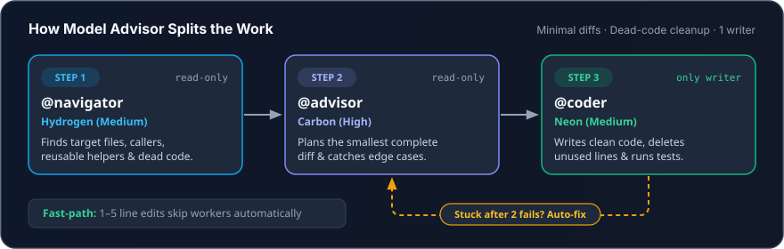
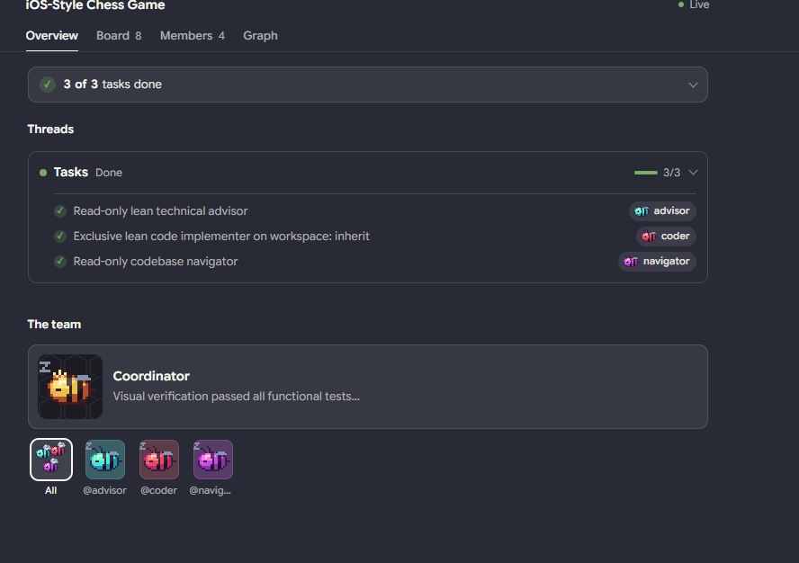

<p align="center">
  
</p>

<h1 align="center">Model Advisor</h1>

<p align="center">
  <strong>Split coding tasks across specialized AI models in Google Antigravity — with cleaner, smaller diffs and a built-in Customize UI.</strong>
</p>

<p align="center">
  
  
  
</p>

---

## What Is Model Advisor?

Instead of making one AI model do everything, **Model Advisor** routes each step of a coding task to the best model for that job:

- **Hydrogen** quickly scouts your codebase (read-only)
- **Carbon** plans the cleanest approach and fixes stubborn bugs (read-only)
- **Neon** writes the code and runs tests (exclusive file writer)

It also enforces **lean-code discipline** — reusing existing code, keeping diffs small, and removing unused lines automatically.

<p align="center">
   Advisor (Carbon) -> Coder (Neon)" width="100%" />
</p>

---

## Live Preview in Antigravity

When working on a real task, Antigravity's **Swarm Overview** shows each specialist completing its part:

<p align="center">
  
</p>

---

## Why Use It?

- **Faster & smarter split:** Cheap, fast reading (`Hydrogen`), deep thinking (`Carbon`), and quick coding (`Neon`).
- **Less code bloat:** Built-in lean rules stop AI from over-engineering or leaving dead code behind.
- **No endless bug loops:** If a build or test fails twice, Neon stops guessing and asks Carbon for the root cause.
- **No merge headaches:** Only `@coder` edits files, so workers never conflict.
- **Free when idle:** Sleeping workers cost 0 tokens while remembering your codebase and plan.
- **Built-in Customize UI (0 token cost):** Change models or modes anytime from Antigravity's Side Pane or Left Sidebar.

---

## Modes at a Glance

Type `/model-advisor` in chat to switch modes anytime (sticks for the rest of the session):

| Command | Best For | How It Runs |
| :--- | :--- | :--- |
| `/model-advisor-hybrid` *(default)* | Everyday coding | Your main chat codes on **Neon**; **Hydrogen** & **Carbon** help in the background. |
| `/model-advisor-swarm` | Big refactors or using another main model | Main chat only manages; all 3 roles run as separate workers. |
| `/model-advisor-default` | Quick changes / normal chat | Turns off multi-model workers while keeping lean-code rules. |

> **Tip:** Tiny 1–5 line edits and regular questions automatically skip workers so you never wait unnecessarily.

---

## Sample Use Cases

- **Build a feature** *(automatic in Hybrid mode)*:
  > *"Add rate limiting to `/api/login` and add a test."*
  > Hydrogen finds the auth files → Carbon designs the smallest plan → Neon writes the code and runs tests.
- **Fix a stubborn error**:
  > When tests fail twice, Neon pauses and hands the error + diff to Carbon, who pinpoints the root cause and smallest fix.
- **Clean up & refactor**:
  > `/model-advisor-swarm Refactor checkout to reuse the currency helper and delete unused formatters.`
- **Quick single-model edit**:
  > `/model-advisor-default Rename the sidebar button label.`

---

## Installation

### Quick Install (1 Minute)

**Using Antigravity CLI:**
```bash
git clone https://github.com/kebintong/Model-advisor.git
agy plugin install ./Model-advisor
```

**Or copy directly into Antigravity's global plugins folder** *(loads automatically, no restart needed)*:

- **Windows (PowerShell):**
  ```powershell
  git clone https://github.com/kebintong/Model-advisor.git "$HOME\.gemini\config\plugins\model-advisor"
  ```
- **macOS / Linux:**
  ```bash
  git clone https://github.com/kebintong/Model-advisor.git ~/.gemini/config/plugins/model-advisor
  ```

<details>
<summary><strong>Need Prerequisites? Click to expand (Antigravity, Git, Node.js 18+)</strong></summary>

1. **Google Antigravity** — Download and sign in at [antigravity.google](https://antigravity.google).
2. **Git** — Verify with `git --version`:
   - Windows: `winget install --id Git.Git -e --source winget`
   - macOS: `brew install git`
   - Linux (Ubuntu/Debian): `sudo apt update && sudo apt install -y git`
3. **Node.js 18+** *(optional — only needed for the Customize UI panel)* — Verify with `node -v`:
   - Windows: `winget install --id OpenJS.NodeJS.LTS -e --source winget` *(or [nodejs.org](https://nodejs.org))*
   - macOS: `brew install node`
   - Linux (Ubuntu/Debian): `curl -fsSL https://deb.nodesource.com/setup_lts.x | sudo -E bash - && sudo apt install -y nodejs`

</details>

---

## Customize Your Models

Open **Model Advisor** from the **Left Sidebar** or **`+` in the Side Pane** to pick any model for each role, switch active mode, or toggle lean-code rules. Changes save directly to `config.json` with zero AI token usage.

You can also just ask in chat (e.g., *"change advisor to Carbon Medium"*).

<details>
<summary><strong>Manual <code>config.json</code> &amp; Plugin Structure</strong></summary>

```json
{
  "defaultMode": "hybrid",
  "models": {
    "navigator": "gemini-4-hydrogen-medium",
    "advisor": "gemini-4-carbon-high",
    "coder": "gemini-4-neon-medium"
  },
  "leanCode": true
}
```

```text
model-advisor/
├── plugin.json                        # Plugin manifest
├── config.json                        # Saved mode, role models & lean-code toggle
├── mcp_config.json                    # Connects the Customize UI MCP App
├── assets/                            # Plugin icon, workflow graphic & preview
├── rules/AGENTS.md                    # Always-on routing & lean-code rule
├── server/                            # Zero-dependency Node server + bundled UI
└── skills/                            # Core skill + /model-advisor-{hybrid,swarm,default}
```

</details>

---

## License

[MIT](LICENSE)
