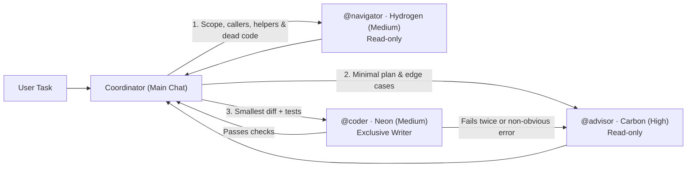

# Model Advisor

An always-on multi-model routing plugin for **Google Antigravity** inspired by the Advisor pattern — combining specialized model delegation (**Hydrogen**, **Carbon**, **Neon**), **lean senior-dev coding discipline** (minimal diffs, reuse first, dead-code removal), and a built-in **Customize UI** with zero runtime npm dependencies.

---

## What It Is About

Instead of asking one model to read your whole repo, plan architecture, write code, and untangle stubborn build errors all at once, **Model Advisor** splits each phase to a specialist pinned via Antigravity's native `swarm` tool — while enforcing strict minimal-diff rules so multi-agent collaboration stays fast, focused, and bloat-free.

It ships as one self-contained Antigravity plugin containing:
- **Always-on routing rule** (`rules/AGENTS.md`) with automatic fast-path skipping for tiny 1–5 line edits
- **Mode slash commands** (`/model-advisor-hybrid`, `/model-advisor-swarm`, `/model-advisor-default`)
- **Lean-code discipline** baked into every worker brief
- **Interactive Customize UI** (Side Pane `+` menu & Left Sidebar) synced two-way with `config.json` at **0 LLM token cost**

---

## How It Works



### Roles & Default Models

| Member | Default Model ID | Access | Responsibility |
| :--- | :--- | :--- | :--- |
| **Coordinator** | Main chat | Orchestrates *(codes in `hybrid` if on Neon)* | Manages context handoffs, updates Swarm Overview (`plan.json`), verifies results, and reports concisely. |
| **`@navigator`** | `gemini-4-hydrogen-medium` | **Read-only** | Fast codebase scout — maps target files & line ranges, impacted callers/tests/exports, reusable repo helpers, and dead code. |
| **`@advisor`** | `gemini-4-carbon-high` | **Read-only** | Deep planner & debugger — designs the smallest complete diff, catches risks, and diagnoses root causes after 2 failed fix attempts. |
| **`@coder`** | `gemini-4-neon-medium` | **Exclusive writer** | Implements `@advisor`'s minimal diff, deletes listed dead code, and runs build/test verification. Only `@coder` edits files. |

### Operating Modes (Sticky per Session)

| Command | Mode | What It Does |
| :--- | :--- | :--- |
| `/model-advisor-hybrid` *(or `/model-advisor`)* | **Hybrid** *(default)* | Main chat codes directly on Neon; `@navigator` (Hydrogen) and `@advisor` (Carbon) run as read-only swarm workers. Falls back to spawning `@coder` if main chat is on another model. |
| `/model-advisor-swarm` | **3-Worker Swarm** | Main chat coordinates only (never edits files). Delegates to all 3 separate pinned workers (`@navigator`, `@advisor`, `@coder`). |
| `/model-advisor-default` | **Default** | Single-model direct mode. Spawns no workers; main chat handles everything while keeping lean-code rules active. |

- **Fast-path skip:** Trivial 1–5 line edits and pure Q&A bypass workers automatically unless you explicitly invoke `/model-advisor-hybrid` or `/model-advisor-swarm`.
- **Live Indicators:** Shows the active model in Antigravity's status label (`Hydrogen (med): navigating codebase`), populates friendly outcome-grouped threads in the built-in **Swarm Overview**, and appends a 1-line model trail to replies.

---

## Benefits

- **Right model for every phase:** Fast scout for reading (`Hydrogen`), deep reasoning for planning & debugging (`Carbon`), and fast execution for edits (`Neon`).
- **Prevents multi-agent over-engineering:** Built-in lean-code rules prioritize reusing existing helpers/stdlib, deleting dead code, and shipping the shortest readable working diff — without cutting security, validation, or data-loss handling.
- **Breaks debugging loops automatically:** After 2 failed fix attempts (or any non-obvious failure), execution stops guessing and escalates the failing command, trace, and diff to `@advisor` for a root-cause fix.
- **Zero-cost idle workers:** Swarm workers sleep in `waiting` state between turns at 0 cost while retaining codebase and plan memory.
- **Live Customize UI at 0 token cost:** Change default mode, toggle lean-code rules, or swap any role's model ID from the Side Pane or Left Sidebar; changes persist to `config.json` over local stdio without calling an LLM.
- **Single-writer safety:** Because only `@coder` has write access on `workspace: "inherit"`, there are no merge conflicts or worktree cleanup headaches.

---

## Sample Use Cases

### 1. Building a New Feature (`hybrid` — Automatic)
Set your main chat to **Gemini 4 Neon (Medium)** and prompt normally:
```text
Add rate limiting to the /api/login endpoint and cover it with tests.
```
1. `@navigator` (Hydrogen) maps the auth router, existing middleware helpers, and test setup.
2. `@advisor` (Carbon) produces a minimal step-by-step plan reusing existing middleware and flagging edge cases.
3. Main chat (Neon) applies the minimal diff and runs the test suite.

### 2. Escaping a Stubborn Build or Test Error
During implementation, tests fail twice with an unfamiliar error:
1. Neon stops iterating blindly and hands the failing command, stack trace, and current diff to `@advisor` (Carbon).
2. Carbon identifies the root cause in 2–3 sentences and returns the smallest shared-code fix.
3. Neon applies the patch and confirms tests pass.

### 3. Refactoring & Dead-Code Cleanup (`swarm`)
Force full 3-worker separation regardless of your main chat model:
```text
/model-advisor-swarm Refactor billing checkout to use the shared currency helper and remove unused legacy formatters.
```
- Main chat orchestrates only; `@navigator` finds all callers and unused formatters, `@advisor` plans the safe deletion + refactor, and `@coder` executes and verifies.

### 4. Quick Single-Model Bypass (`default`)
Skip workers entirely for rapid back-and-forth exploration or small changes while keeping minimal diffs:
```text
/model-advisor-default Rename the sidebar button label and update its snapshot test.
```

---

## Installation Guide

### Prerequisites
- **Google Antigravity** (App, IDE, or CLI `agy`)
- **Node.js 18+** on `PATH` *(required only for the optional built-in Customize UI MCP server; skills and routing rules work without Node)*

### Option A: Install via Antigravity CLI *(Recommended)*
```bash
git clone https://github.com/kebintong/Model-advisor.git
agy plugin install ./Model-advisor
```

### Option B: Manual Global Install
Clone directly into Antigravity's global plugins folder (auto-discovered live, no restart required):

**Windows (PowerShell):**
```powershell
git clone https://github.com/kebintong/Model-advisor.git "$HOME\.gemini\config\plugins\model-advisor"
```

**macOS / Linux:**
```bash
git clone https://github.com/kebintong/Model-advisor.git ~/.gemini/config/plugins/model-advisor
```

### Verify & Toggle
1. Open **Customizations → Plugins → Model Advisor** in Antigravity to verify it is enabled (you can toggle Always-On behavior live with one click).
2. Open the Customize UI via **`+` in the Side Pane → Model Advisor** or **Model Advisor** in the Left Sidebar.
3. Type `/model-advisor` in chat to see the 4 registered commands (`model-advisor`, `model-advisor-hybrid`, `model-advisor-swarm`, `model-advisor-default`).

---

## Customization

Edit settings from the **Model Advisor** Side Pane / Sidebar UI, via chat (*"change advisor to Carbon Medium"*), or directly in `config.json`:

```json
{
  "defaultMode": "hybrid",
  "models": {
    "navigator": "gemini-4-hydrogen-medium",
    "advisor": "gemini-4-carbon-high",
    "coder": "gemini-4-neon-medium"
  },
  "leanCode": true
}
```

> **Using different models?** The UI dropdown includes Gemini 4 (Hydrogen, Carbon, Neon, Argon), Claude 5.5 (Opus, Sonnet), Gemini 3.8 Flash, GPT-OSS, plus a **Custom model ID** input — so you can point any role to whichever models your Antigravity account provides.

---

## Plugin Structure

```text
model-advisor/
├── plugin.json                        # Plugin manifest
├── config.json                        # Active mode, role models, lean-code toggle
├── mcp_config.json                    # Registers local Customize UI MCP App server
├── assets/
│   └── logo.svg                       # Plugin icon
├── rules/
│   └── AGENTS.md                      # Always-on routing & lean-code rule
├── server/
│   ├── server.mjs                     # Zero-dependency Node.js stdio MCP server
│   └── app.html                       # Pre-bundled single-file MCP App UI
└── skills/
    ├── model-advisor/SKILL.md         # Core workflow, brief templates & Swarm Overview rules
    ├── model-advisor-hybrid/SKILL.md  # /model-advisor-hybrid
    ├── model-advisor-swarm/SKILL.md   # /model-advisor-swarm
    └── model-advisor-default/SKILL.md # /model-advisor-default
```

---

## License

MIT
